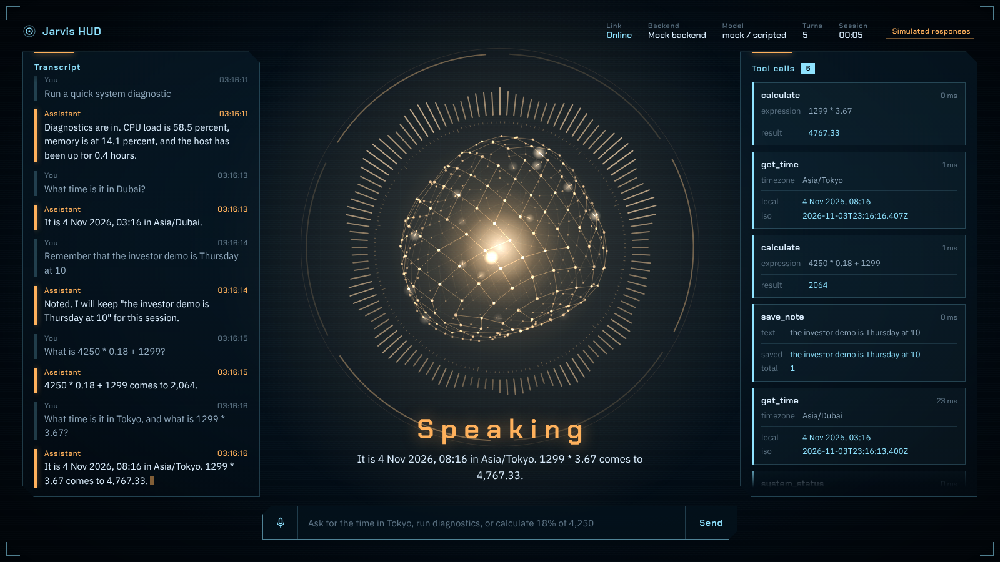
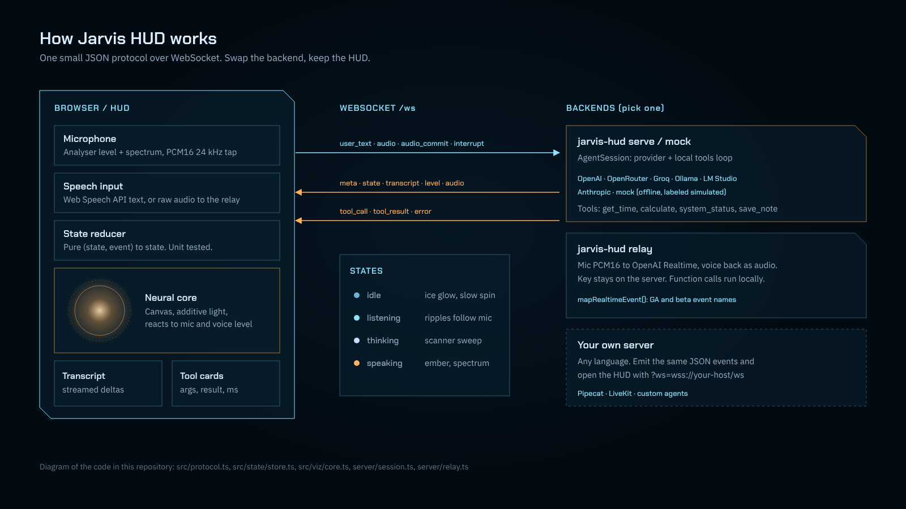

# Jarvis HUD

**A cinematic, open-source heads-up display for voice AI assistants in the browser.** It includes a mic-reactive neural core, a live transcript and tool-call cards. It works with the OpenAI Realtime API, any LLM through a small agent backend, or your own WebSocket server.

[](https://github.com/mohammadhadijavidi/jarvis-hud/actions/workflows/ci.yml)
[](LICENSE)
[](package.json)
[](tsconfig.json)



<sub>Real screenshot of the HUD driven by the bundled **mock backend** (`scripts/screenshot.py`). The replies are scripted and the HUD says so ("Simulated responses"). The tool results are real: the tools ran locally (clock, arithmetic, host CPU and memory).</sub>

## Why

Most "Jarvis" projects on GitHub are a complete assistant with a UI attached. They come with a fixed model, a fixed speech stack and a UI you can't reuse. Voice agent frameworks (Pipecat, LiveKit Agents, the OpenAI Realtime API) take the opposite approach: a solid backend with a minimal demo page on top.

Jarvis HUD covers the frontend only:

- **Backend-agnostic.** A small JSON-over-WebSocket protocol (8 server events, 5 client events). Anything that can emit those events can drive the HUD: Node, Python, Go, a Pipecat pipeline, or the included relays.
- **Built for real agents.** Tool calls show up as cards with arguments, results, status and timing. Speech streams in word by word. The listening, thinking and speaking states are clearly distinct.
- **Honest by design.** Backends declare `simulated: true` when no real model is involved, and the HUD shows a badge for it.
- **Small and dependency-light.** Vite and TypeScript with no UI framework. The renderer is Canvas 2D, so it runs on laptops without a GPU. The production bundle is about 23 kB of JS (9 kB gzipped), plus fonts.

## Features

- **Neural core visualization:** a Fibonacci-lattice sphere of 360 nodes. It deforms with voice level, sends signal pulses along its edges, and has a radial spectrum ring with counter-rotating instrument rings. Each state has its own colour and motion: ice blue when idle or listening, a scanner sweep while thinking, ember while speaking.
- **Mic-reactive:** a Web Audio analyser drives the core from your voice. Speech-to-speech backends also get an AudioWorklet tap that streams 24 kHz PCM16.
- **Voice playback:** gapless PCM16 playback for audio streamed back by the backend. The assistant's real voice level animates the core.
- **Live transcript:** streamed deltas, user and assistant turns, and a typing cursor while the assistant is speaking.
- **Tool-call cards:** running, ok and error states, compact argument and result rows (echoed arguments are hidden), and durations.
- **Telemetry bar:** link status, backend, provider and model, turn count, session clock.
- **Three backends included:**
  - `mock`: offline, deterministic, no API key needed (for demos and CI)
  - `serve`: an agent loop with function calling, using **OpenAI, OpenRouter, Groq, Ollama, LM Studio, any OpenAI-compatible server, or Anthropic**
  - `relay`: an **OpenAI Realtime API** speech-to-speech relay. Your API key stays on the server and tools run locally.
- **Responsive and accessible:** works at desktop, tablet and phone sizes. Has keyboard focus styles, `aria-live` regions and `prefers-reduced-motion` support. Press `Esc` to interrupt.
- **Tested:** 63 Vitest tests covering the protocol parser, state reducer, audio maths, geometry, the Realtime event mapper and relay, providers (with fake fetch), the agent session, and an end-to-end WebSocket round trip.

## Quick start

Requires Node 20 or newer.

```bash
git clone https://github.com/mohammadhadijavidi/jarvis-hud.git
cd jarvis-hud
npm install
npm run build
npm run mock          # serves the HUD and mock backend on http://127.0.0.1:8787
```

Open http://127.0.0.1:8787 and try typing *"What time is it in Tokyo, and what is 1299 * 3.67?"*

Development with hot reload (two terminals):

```bash
npm run mock          # backend on :8787
npm run dev           # Vite on http://localhost:5173, proxies /ws to :8787
```

### With a real model

```bash
cp .env.example .env
# set JARVIS_PROVIDER and the matching API key, then:
npm run serve
```

### OpenAI Realtime (speech to speech)

```bash
OPENAI_API_KEY=sk-... npm run relay
```

Click the mic button and speak. Audio goes from the HUD through the relay to OpenAI Realtime and back. Voice activity detection runs on the server, and function calls run locally and their results are returned to the model.

## Configuration

All configuration uses environment variables (or `.env`). See [`.env.example`](.env.example).

| `JARVIS_PROVIDER` | Backend | Key variable | Default model | Default base URL |
| --- | --- | --- | --- | --- |
| `mock` | Scripted, offline, labeled simulated | none | `scripted` | none |
| `openai` | OpenAI Chat Completions + tools | `OPENAI_API_KEY` | `gpt-4o-mini` | `https://api.openai.com/v1` |
| `openrouter` | OpenRouter | `OPENROUTER_API_KEY` | `openai/gpt-4o-mini` | `https://openrouter.ai/api/v1` |
| `groq` | Groq | `GROQ_API_KEY` | `llama-3.3-70b-versatile` | `https://api.groq.com/openai/v1` |
| `ollama` | Local Ollama | none | `llama3.1` | `http://localhost:11434/v1` |
| `lmstudio` | Local LM Studio | none | `local-model` | `http://localhost:1234/v1` |
| `openai-compatible` | vLLM, llama.cpp server, etc. | `JARVIS_API_KEY` (optional) | `default` | `http://localhost:8000/v1` |
| `anthropic` | Anthropic Messages API + tool use | `ANTHROPIC_API_KEY` | `claude-sonnet-4-5` | `https://api.anthropic.com` |

Overrides: `JARVIS_MODEL`, `JARVIS_BASE_URL`, `JARVIS_API_KEY`, `JARVIS_TEMPERATURE`, `JARVIS_SYSTEM_PROMPT`.
Realtime relay: `OPENAI_API_KEY`, `OPENAI_REALTIME_MODEL` (default `gpt-realtime`), `OPENAI_REALTIME_VOICE` (default `marin`).
Server: `PORT` (8787), `HOST` (127.0.0.1).
Frontend: `VITE_JARVIS_WS_URL` at build time, or `?ws=wss://host/ws` in the page URL.

## Usage examples

**CLI**

```bash
node bin/jarvis-hud.mjs mock  --port 8787 --open
node bin/jarvis-hud.mjs serve --host 0.0.0.0
node bin/jarvis-hud.mjs relay
```

**Point the HUD at your own backend**

```text
http://localhost:5173/?ws=ws://127.0.0.1:8790
```

**Write a backend in any language.** A complete Node example is in [`examples/custom-backend.mjs`](examples/custom-backend.mjs) and a Python one is in [`examples/python_backend.py`](examples/python_backend.py). A whole turn looks like this:

```js
send({ type: 'meta', backend: 'My agent', provider: 'openai', model: 'gpt-4o', simulated: false });
send({ type: 'transcript', id: 'u1', role: 'user', text: 'Turn on the lights', final: true });
send({ type: 'state', state: 'thinking' });
send({ type: 'tool_call', id: 't1', name: 'lights_on', args: { room: 'studio' } });
send({ type: 'tool_result', id: 't1', status: 'ok', result: { on: true }, ms: 120 });
send({ type: 'state', state: 'speaking' });
send({ type: 'transcript', id: 'a1', role: 'assistant', text: 'Studio lights' });
send({ type: 'transcript', id: 'a1', role: 'assistant', text: ' are on.', delta: true, final: true });
send({ type: 'level', value: 0.6 });   // or stream { type: 'audio', data: <base64 pcm16> }
send({ type: 'state', state: 'idle' });
```

**Test a backend headlessly**

```bash
node examples/protocol-client.mjs "what time is it in Dubai" "what is 12 * 7"
```

### Protocol reference

| Direction | Event | Fields |
| --- | --- | --- |
| server to HUD | `meta` | `backend`, `provider?`, `model?`, `simulated?`, `accepts?: ('text'\|'audio')[]` |
| | `state` | `state: idle \| listening \| thinking \| speaking` |
| | `transcript` | `id`, `role: user \| assistant \| system`, `text`, `delta?`, `final?` |
| | `tool_call` | `id`, `name`, `args?` |
| | `tool_result` | `id`, `status: ok \| error`, `result?`, `ms?` |
| | `level` | `value` 0..1 (voice level when not streaming audio) |
| | `audio` | `data` base64 PCM16 mono, `sampleRate?` (24000) |
| | `error` | `message` |
| HUD to server | `hello`, `user_text`, `audio`, `audio_commit`, `interrupt` | see [`src/protocol.ts`](src/protocol.ts) |

Malformed events are dropped by `parseServerEvent`, so a misbehaving backend can't crash the UI.

## How it works



1. **Input.** The mic feeds an `AnalyserNode` (level and spectrum for the core). If the backend accepts `audio`, an AudioWorklet also streams 24 kHz PCM16. If not, the browser's Web Speech API turns speech into `user_text`.
2. **Protocol.** `HudClient` maintains a reconnecting WebSocket. All incoming events are validated by `parseServerEvent`.
3. **State.** A pure reducer (`src/state/store.ts`) folds events into `HudState`: transcript, tools, state, meta, turns. The DOM panels are rendered from that state with keyed, incremental updates.
4. **Visualization.** `NeuralCore` (`src/viz/core.ts`) draws each frame with additive blending. Its inputs are the assistant state, the user mic level, and the assistant voice level (from real audio playback when available, otherwise the backend's `level` events).
5. **Backends.** `AgentSession` (`server/session.ts`) runs the provider and tool loop and streams the answer. `RealtimeRelay` (`server/relay.ts`) maps OpenAI Realtime events (GA and beta names) to the HUD protocol and executes function calls with the same local tools.

Built-in tools (`server/tools.ts`): `get_time` (IANA time zones), `calculate` (safe parser, no `eval`), `system_status` (real CPU, memory and uptime of the host), `save_note` (session memory). Add your own by pushing objects with `name`, `description`, `parameters` (JSON Schema) and `run()`.

## Roadmap

- [ ] Optional Three.js/WebGL core with bloom post-processing (the Canvas core stays the default)
- [ ] Theme presets (ice and ember, monochrome, high-contrast) via CSS tokens
- [ ] Barge-in: auto-interrupt playback when the user starts speaking
- [ ] Pipecat and LiveKit adapter examples
- [ ] Persian/Arabic RTL transcript layout
- [ ] Embeddable `<jarvis-hud>` web component build

## Contributing

PRs are welcome. See [CONTRIBUTING.md](CONTRIBUTING.md). Run `npm run typecheck && npm test && npm run build` before opening one.

## License

[MIT](LICENSE) © 2026 Mohammad Hadi Javidi

---

Built by [Mohammad Hadi Javidi](https://github.com/mohammadhadijavidi) — AI products & automation, Dubai.
